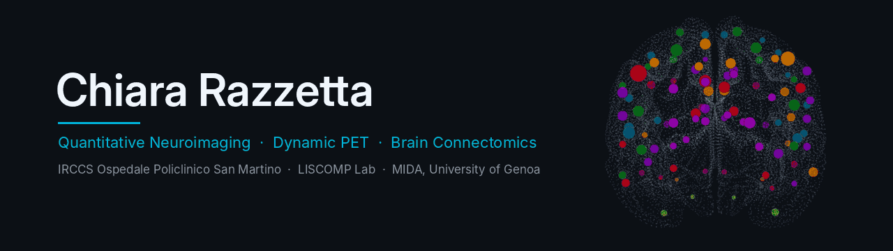
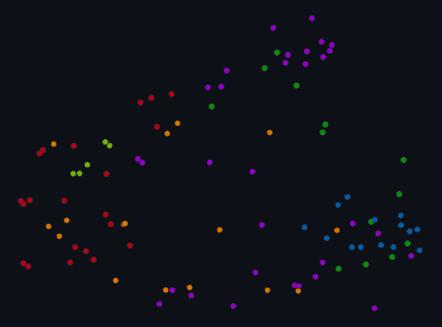

  

### Hi, I'm Chiara 👋

Health Researcher at **IRCCS Ospedale Policlinico San Martino** (Genova), working at the
**LISCOMP Lab** (Life Science COMputational Laboratory) in collaboration with the
**MIDA group** at the Department of Mathematics (DIMA), University of Genoa.

---

### 🔬 Research interests

- **Biomedical data analysis** — statistical modelling of clinical, imaging and omics data
- **Compartmental analysis of dynamic PET images** — kinetic modelling and parameter estimation
- **Brain connectomics** — graph kernels for multimodal connectome analysis
- **Machine learning for clinical applications**
- **Inverse problems and biomedical signal processing**

  
   
  <i>Regional shifts of the brain connectome, coloured by functional network</i>

---

### 🛠️ Software

| Project | Description | Stack |
|:--|:--|:--:|
| **[parUST](https://github.com/chiararazzetta/parUST)** | Parallel parametric ultrasound transmission simulator, beam patterns on CPU or GPU |  |
| **[WWL connectome](https://github.com/theMIDAgroup/WWL_connectome_kernel)** | Wasserstein Weisfeiler–Lehman graph kernels for multimodal brain connectome analysis, developed with the [MIDA group](https://github.com/theMIDAgroup) |  |

---

### 🧰 Tools

  
  
  
  
  

---

### 📫 Find me

  
  

